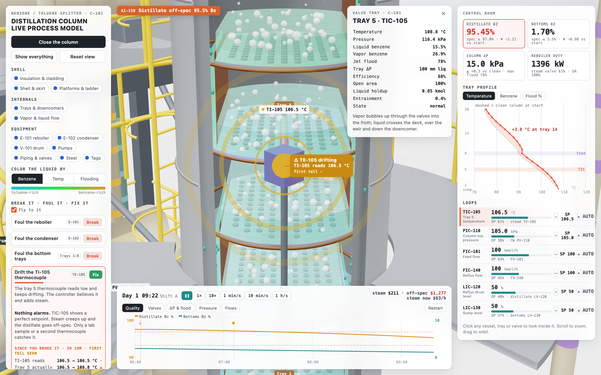

# Process Sim

**Model your process. Break it on purpose. Learn what failure looks like before it costs you.**

**[Open the live distillation column →](https://ivanegetov-lab.github.io/process-sim/examples/distillation-column/)** (runs in your browser, nothing to install)

A Claude skill for staff engineers, maintenance managers, reliability engineers and the people who train operators. Describe a unit, or hand it an equipment list, a P&ID or your SOPs, and it builds a live simulation you can open in a browser:

- **A 3D model you can open up.** Peel the cladding off and see inside: trays, tube bundles, liquid levels, vapor bubbling up, liquid running down.
- **A real dynamic model underneath.** Mass balances, hydraulics, heat transfer, column pressure, PI control loops, interlocks. Every number on screen is calculated.
- **A control room.** Product quality, pressure drop, duties, a live profile against the clean unit, loop faceplates you can switch to manual, trends, alarms, and the running cost of utilities and off-spec product.
- **Break it, foul it, fix it.** Foul an exchanger, drift a thermocouple, dislodge a tray, trip the cooling water. The camera flies to the problem, the equipment lights up, and the sim shows the **first tell**: the number already on the board that moves hours before any alarm. Then fix it and watch it recover.



## The example: C-101 benzene/toluene splitter

20 valve trays, kettle reboiler on LP steam, water-cooled condenser, reflux drum, two pumps, six PI loops, a high-pressure steam trip and a relief valve. Ten faults:

| Fault | First tell (before any alarm) |
|---|---|
| Reboiler fouling | Steam valve creeps from 59% open toward 100% while quality looks fine. About 7 hours of warning before the bottoms goes off spec. |
| Condenser fouling | Cooling-water valve opens wider while pressure holds. About 6 hours of warning. |
| Bottom-tray fouling | Column ΔP climbs. About 9 hours before quality moves. |
| Thermocouple drift | The board shows a perfect setpoint while the real tray runs hot. No temperature alarm. |
| Dislodged tray | Quality slips a little and stays slipped. |
| Reflux valve fails shut | Reflux to zero, top temperature jumps, off spec in minutes. |
| Cooling water pump trip | Pressure climbs fast, the high-high trip cuts the steam. |
| Steam header sag | Same symptom as a fouled reboiler, but in minutes. |
| Feed swing | The controls absorb it. A disturbance, not a failure. |
| Bottoms pump cavitation | Level valve wide open, sump still rising, then liquid backs up the trays. |

The tell timing is checked, not assumed: `scripts/check_tells.mjs` runs every fault and confirms the tell comes before the first alarm.

It's a training model: ideal vapor-liquid equilibrium, constant molar overflow, saturated liquid feed. Good for understanding how a column behaves and fails. Not for design or sizing.

## Try it

You need [Claude Code](https://claude.com/claude-code).

```bash
git clone https://github.com/ivanegetov-lab/process-sim ~/.claude/skills/process-sim
```

Then, in Claude Code:

```
/process-sim
```

or just ask: *"Model our boiler feedwater system and let me break the level transmitter."* Claude will interview you about the unit (equipment, normal operating numbers, control loops, what has actually gone wrong), build and test the model, design the faults and their first tells, and hand you a folder that runs in any browser.

To run the example locally:

```bash
cd ~/.claude/skills/process-sim/examples/distillation-column
python3 -m http.server 8787        # then open http://localhost:8787/
node test-sim.mjs all              # the model's response to every fault, in numbers
node ../../scripts/check_tells.mjs sim.js tells.mjs
```

## How it works

1. **Interview.** Claude asks about your unit and uses your numbers. If a number is missing, it uses a textbook value and says so. It never invents your plant data or your incidents.
2. **Model.** One plain JavaScript file with the physics, tested in Node before anything is drawn.
3. **Faults and tells.** Each fault is one physical change (UA drops, a measurement drifts, a valve goes to its fail position), so the rest of the model produces the symptoms on its own. Each one gets a first-tell rule, checked against the alarms.
4. **Scene.** three.js geometry built from a small kit (vessels, exchangers, pumps, valves, pipes with flow, platforms, cutaways), plus the control room.

## What's in here

```
SKILL.md                      the skill
references/                   interview, modeling guide, fault design, UI guide
scripts/check_tells.mjs       first tell vs first alarm, for every fault
examples/distillation-column/ the live column (sim.js, scene.js, app.js, index.html)
```

MIT license. Built by Ivan Getov: chemical engineer, distillation technical staff for most of his career, then maintenance manager for the same columns.
